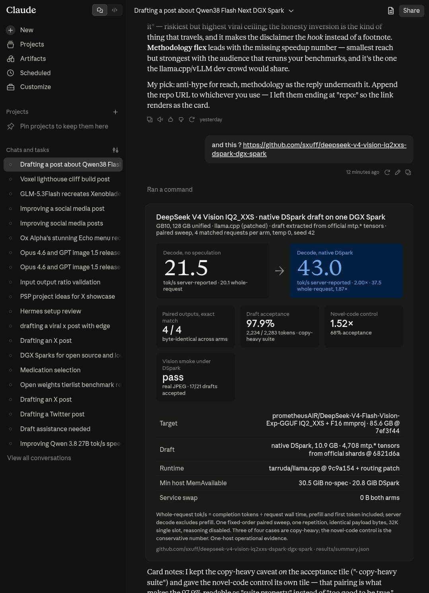

# DeepSeek V4 Vision IQ2_XXS + native DSpark on one DGX Spark

A pinned llama.cpp recipe for serving `prometheusAIR/DeepSeek-V4-Flash-Vision-Exp-GGUF` IQ2_XXS with native image input and an external DSpark speculative draft on one NVIDIA GB10 system.



DSpark is the default general-generation profile. `ngram-mod` is retained as a measured copy-heavy profile, and no-spec is the correctness control.

## Measured comparison

One fixed-order paired sweep used four deterministic text requests per arm with identical payload bytes, one repetition, temperature 0, seed 42, and reasoning disabled.

| Mode | Aggregate whole-request completion rate | Server decode rate | Exact paired outputs |
|---|---:|---:|---:|
| No speculation | 20.05 tok/s | 21.50 tok/s | 4/4 |
| Native DSpark | **37.47 tok/s** | **43.01 tok/s** | 4/4 |

- Aggregate whole-request speedup: **1.87x**
- Server decode speedup: **2.00x**
- DSpark acceptance: **2,234 / 2,283 tokens, 97.85%**
- Matched request payloads: **4/4**
- Minimum host `MemAvailable`: **30.52 GiB no-spec**, **20.81 GiB DSpark**
- Service swap: **0 bytes in both arms**
- Host swap growth: **4 KiB no-spec**, **6.77 MiB DSpark**

Whole-request tok/s is total completion tokens divided by total request wall time, including prefill and first-token latency. Server decode tok/s excludes prefill.

The suite is intentionally small and copy-heavy in three of four cases. The novel-code control improved by **1.52x** with **68.06%** acceptance. Treat the aggregate as one-host operational evidence, not a general model benchmark.

## Native vision smoke

The same DSpark service accepted a real JPEG through the separate F16 projector and returned:

> The image shows a group of bright orange carrots with small green stems, resting against each other on a white background.

The request completed with 24 output tokens, 17/21 draft tokens accepted, and a `stop` finish reason. This proves DSpark and native vision operated together; it is not a matched vision speed comparison.

## Exact stack

- Target: `prometheusAIR/DeepSeek-V4-Flash-Vision-Exp-GGUF` at `7ef3f44de46f7ab004257c0187e63b3b199e14e6`
- Target variant: four IQ2_XXS shards plus F16 `mmproj`, **85,585,821,888 bytes**
- Draft source: `deepseek-ai/DeepSeek-V4-Flash-Vision-Exp` at `6821d6ad3681a4b137b066b76094fa82ebd0a380`
- Draft extraction: 4,708 `mtp.*` tensors from the final three official safetensor shards
- Generated native draft: **10,896,058,816 bytes**, SHA-256 `4bd6ec83b6b31531a55459ee07b7eaede380ccd6a60cbe13003ec7ccf1eb2d77`
- Runtime: `tarruda/llama.cpp` at `9c9a1546d0159781f96e5c1c9ba479e74ecb54c4` plus the exercised routing patch
- Hardware: one NVIDIA DGX Spark or equivalent GB10, 128 GB unified memory
- Allocated context: 32,768 tokens, one slot

Exact sizes and hashes are in [`manifests`](manifests).

## Download the target

```bash
MODEL_DIR="$HOME/models/DeepSeek-V4-Flash-Vision-Exp-IQ2_XXS" python3 scripts/download_target.py
```

The downloader pins the Hub revision, resumes partial files, and verifies all target shards plus the projector.

## Download and extract DSpark

Only the final three official source shards are needed for the `mtp.*` scope:

```bash
python3 scripts/download_dspark_source.py
LLAMA_ROOT=/path/to/patched/llama.cpp ./scripts/convert_dspark.sh
```

The conversion produces the exercised native mixed-type DSpark GGUF. It does not produce the unpublished Q2_K draft referenced by the target repository's benchmark.

## Build the exact runtime

```bash
./scripts/build_runtime.sh
```

The build script fetches the exact runtime commit, verifies and applies the exercised patch, then builds for `121a-real`.

## Serve

Default general-generation profile:

```bash
MODE=dspark MODEL_DIR=/path/to/target DRAFT=/path/to/DeepSeek-V4-Flash-Vision-Exp-DSpark-Native.gguf ./scripts/serve.sh
```

Copy-heavy profile:

```bash
MODE=ngram MODEL_DIR=/path/to/target ./scripts/serve.sh
```

Correctness control:

```bash
MODE=baseline MODEL_DIR=/path/to/target ./scripts/serve.sh
```

The validated modes require a server restart to switch. A combined n-gram-first plus DSpark-fallback profile is not published as validated evidence here.

## Benchmark

Run each arm against a fresh server load:

```bash
python3 scripts/benchmark.py --arm baseline --output results/local-baseline.json
python3 scripts/benchmark.py --arm dspark --output results/local-dspark.json
python3 scripts/analyze.py   --baseline results/local-baseline.json   --treatment results/local-dspark.json   --output results/local-summary.json
```

The committed [`results/summary.json`](results/summary.json) is sanitized. Raw generations, service logs, and machine-local paths are not published.

## Scope

This is one paired, one-repetition operational sweep on one GB10. It establishes that the pinned target and native DSpark draft load together, preserve all four measured outputs exactly, accelerate the included text cases, pass a native-image smoke, and remain above a 6 GiB host-memory reserve. It does not establish universal model quality parity or a universal speedup.

## Attribution and licenses

llama.cpp provides the runtime and upstream DeepSeek V4 Vision/DSpark implementation. PrometheusAIR provides the exercised IQ2_XXS target and projector. DeepSeek provides the official DSpark source tensors. Model weights are not included and retain their upstream licenses. Repository scripts and documentation are MIT licensed.
